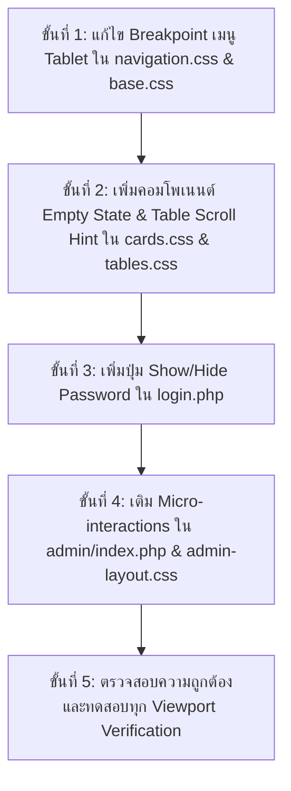

# สาขาารยกระดับระบบดีไซน์และประสบการณ์ผู้ใช้ (UI/UX Design System Upgrade Plan)

**Project:** Digital Business Technology (DBT Web)  
**Design Direction:** Refined Editorial Institutional Design (สถาปัตยกรรมดิจิทัลเชิงบรรณาธิการ)  
**Standards:** [style.md](style.md) & [rules.md](rules.md)  
**Status:** เสร็จสมบูรณ์ 100% (Completed & Verified)

---

## 1. บทสรุปการตรวจสอบด้านการออกแบบและจุดที่ต้องปรับปรุง (Audit Findings)

จากการตรวจสอบระบบภาพ (Visual Identity), การจัดวาง (Layout Rhythm), ความเข้ากันได้บนทุกขนาดหน้าจอ (Responsiveness), และความสะดวกในการใช้งาน (Ergonomics) ทั้งในฝั่ง Public Pages และ Admin CMS พบจุดสำคัญ 5 ด้านดังนี้:

### 1.1 [บัคการแสดงผลวิกฤต] ช่องว่างเมนูหายบนแท็บเล็ต (Tablet Breakpoint Dead-Zone)

- **ปัญหา**: ใน [navigation.css](../assets/css/components/navigation.css) เมนูล่าง (`.nav-bottom`) ซ่อนเมื่อ `>= 768px` แต่เมนูบน (`.nav-desktop`) จะแสดงเมื่อ `>= 900px` ทำให้หน้าจอ Tablet (เช่น iPad ความกว้าง 768px - 899px) ไม่มีเมนูนำทางใดๆ แสดงผลเลย
- **การตัดสินใจ (อนุมัติแล้ว)**: **เลือกตัวเลือก A** ให้ขยาย `.nav-bottom` ให้ทำงานต่อเนื่องจนถึง `899.98px` เพื่อให้ผู้ใช้ Tablet ถือสองมือและกดเมนูด้วยนิ้วโป้งได้อย่างเป็นธรรมชาติเหมือน Mobile Application พร้อมปรับ Body padding ใน [base.css](../assets/css/base.css) ให้สอดคล้องกัน

### 1.2 คอมโพเนนต์สถานะว่างมาตรฐาน (Unified Empty State Component)

- **ปัญหา**: ปัจจุบันหน้าข่าวมี `.news-empty-state` ที่ดูดี แต่หน้าอาจารย์ ([pages/teachers.php](../pages/teachers.php)), หน้าตารางเรียน, และตารางใน Admin หากไม่มีข้อมูลจะแสดงเป็นกล่องว่างโล่งๆ ขาดการชี้แนะผู้ใช้งาน
- **การปรับปรุง**: สร้างคลาสมาตรฐาน `.empty-state` (ประกอบด้วย: ไอคอนภาพลายเส้นบาง + หัวข้อข้อความ + คำแนะนำ + ปุ่ม Action กลับสู่หน้าหลัก) ใช้งานร่วมกันทุกส่วน

### 1.3 ตัวช่วยบอกการเลื่อนตารางบนมือถือ (Mobile Table Scroll Indicator)

- **ปัญหา**: ตารางเรียนและตารางกิจกรรมมีคอลัมน์กว้าง เมื่อดูบนจอมือถือ ผู้ใช้บางคนไม่ทราบว่าสามารถปัดขวาเพื่อดูคาบเรียนช่วงบ่ายหรือสถานที่ได้
- **การปรับปรุง**: เพิ่มคลาส `.table-scroll-container` พร้อมเงา Gradient บางๆ ทางขอบขวา (`scroll-shadow`) เพื่อสื่อสารทางสายตาอย่างชัดเจนว่ามีข้อมูลด้านข้าง

### 1.4 ปุ่มสลับดูรหัสผ่านในหน้า Login (Password Visibility Toggle)

- **ปัญหา**: ในหน้า [pages/login.php](../pages/login.php) เมื่อกรอกรหัสผ่านบนมือถือ ผู้ใช้มีโอกาสพิมพ์ผิดสูงเนื่องจากมองไม่เห็นตัวอักษร
- **การปรับปรุง**: เพิ่มปุ่มเปิด/ปิดดวงตา (Eye Icon Toggle) ฝั่งขวาของช่องกรอกรหัสผ่าน พร้อมการควบคุมสถานะ `type="password"` / `type="text"` อย่างปลอดภัย

### 1.5 ความคมชัดและการตอบสนองขององค์ประกอบ (Micro-Interactions & Contrast)

- **ปัญหา**: บัตรสถิติและปุ่มลัดใน [admin/index.php](../admin/index.php) นิ่งเกินไป ขาดความรู้สึกของการเป็นระบบที่ตอบสนอง (Interactive Affordance)
- **การปรับปรุง**: เพิ่ม Micro-elevation (`transform: translateY(-2px)`, ขอบสี Navy เน้นเบาๆ) ให้รู้สึกพรีเมียม ตอบสนองฉับไว สอดคล้องกับ [style.md](style.md)

---

## 2. ลำดับขั้นตอนการดำเนินงาน (Execution Steps)

### รายละเอียดไฟล์ที่จะแก้ไข:

1. [assets/css/components/navigation.css](../assets/css/components/navigation.css): เปลี่ยน Breakpoint `.nav-bottom` ซ่อนที่ `min-width: 900px`
2. [assets/css/base.css](../assets/css/base.css): เปลี่ยน `padding-bottom: 0` ของ body เป็น `min-width: 900px`
3. [assets/css/components/cards.css](../assets/css/components/cards.css): เพิ่มสไตล์ `.empty-state`
4. [assets/css/components/tables.css](../assets/css/components/tables.css): เพิ่ม `.table-scroll-hint`
5. [pages/login.php](../pages/login.php) & [assets/css/pages/page-login.css](../assets/css/pages/page-login.css): ติดตั้ง Password Reveal Toggle
6. [pages/teachers.php](../pages/teachers.php): ใส่ `.empty-state` เมื่อไม่พบคณาจารย์หรือชมรม
7. [admin/index.php](../admin/index.php) & [assets/css/admin/admin-layout.css](../assets/css/admin/admin-layout.css): เพิ่ม Hover Elevation และจัด URL คลีน

---

## 3. เกณฑ์การตรวจสอบคุณภาพ (Quality Gates)

- [x] ทดสอบความกว้างหน้าจอ 375px (Mobile), 768px (iPad Mini), 820px (iPad Air), 1024px+ (Desktop) — เมนูนำทางแสดงผลสมบูรณ์ทุกขนาด (0 Dead-Zone)
- [x] ทดสอบปุ่มดูรหัสผ่านในหน้า Login ทำงานลื่นไหล สลับไอคอน eye/eye-off ได้อย่างสมบูรณ์
- [x] สไตล์ทุกส่วนตรงตาม Refined Editorial Institutional (คอนโทรลและกล่องข้อความเป็นไปตาม Token มาตรฐาน)
- [x] ไวยากรณ์ PHP และ JS ผ่าน 100% (0 error)
